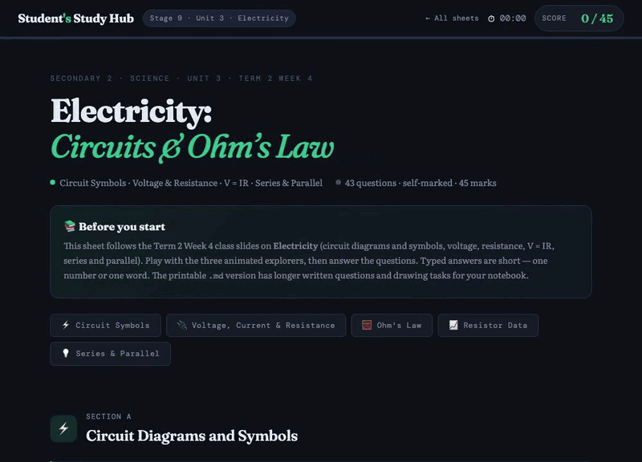

# 📚 Cambridge Practice

**Free, self-marking practice sheets for Cambridge Lower Secondary and IGCSE.**
No login. No install. Works offline.

### 👉 [Start practising](https://jasperf.github.io/cambridge-practice)

  

## ✨ How it works

1. **Pick a sheet:** maths, science or English, by unit or as a full mock exam.
2. **Answer:** multiple choice or numbers, with instant ✅ / ❌ feedback.
3. **Stuck?** Open a hint, or reveal the worked answer. Your score and time update as you go.

## 🧑‍🏫 For teachers

- **Every sheet has a printable version** with the same questions, for pen-and-paper practice or tests.
- **Unit practice, revision handouts and full mock papers**, plus one-page formula and revision sheets.
- **Nothing to set up:** no accounts, no tracking, no server. Share a link or open a file.
- **Free to use and adapt** under the [MIT licence](./LICENSE).

## 📖 What's covered

| Stage | Subjects | |
|---|---|---|
| **Secondary 1** | Maths · Science · English · SA2 revision and topic drills | [Browse →](https://jasperf.github.io/cambridge-practice/#secondary1) |
| **Secondary 2** | Maths · Science · English · Semester 1 mocks · Formula sheets | [Browse →](https://jasperf.github.io/cambridge-practice/#secondary2) |
| **IGCSE Additional Maths (0606)** | Circular measure | [Browse →](https://jasperf.github.io/cambridge-practice/#igcse) |

Want a sheet-by-sheet list? See the term indexes: [S2 Term 1](./s2/t1/README.md) · [S2 Term 2](./s2/t2/README.md) · [S2 Semester 1 mocks](./s2/sem1/README.md).

More videos and revision links are on the [resources page](https://jasperf.github.io/cambridge-practice/resources.html).

## 🛠 Contributing

Plain HTML, CSS and JavaScript, with no build step. See [CONTRIBUTING.md](./CONTRIBUTING.md) to add a sheet or generate PDFs.

---

*Not affiliated with Cambridge Assessment International Education.*
