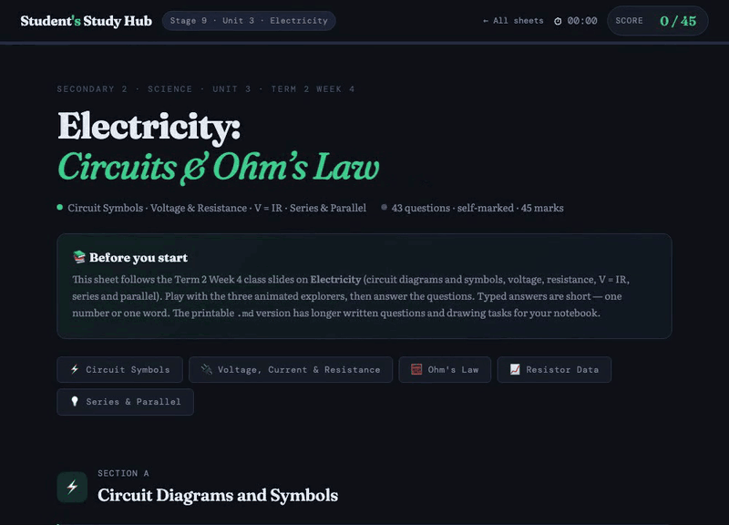

# 📚 Cambridge Practice

**Free, self-marking practice sheets for Cambridge Lower Secondary and IGCSE — plus Bahasa Indonesia and Mandarin.**
No login. No install. Works offline.

### 👉 [Start practising](https://jasperf.github.io/cambridge-practice)

  

## 🌏 Who this is for

The academic sheets follow the **Cambridge pathway** — Lower Secondary (Secondary 1 & 2, ending in Checkpoint), then IGCSE and A-Level — which is how maths, science and English are taught at English-medium international schools such as **SIS South Jakarta** (SIS schools in Indonesia run the Singapore, Cambridge and IB curricula, and SIS South Jakarta has offered the IB Diploma Programme since 2014). On top of the Cambridge subjects, students at schools in Indonesia also study **Bahasa Indonesia** (a required national subject) and **Mandarin Chinese** — so this repo has language practice alongside the academic sheets:

- **Bahasa Indonesia** — Semester 1 mock (Units 1–3), two 40-question vocabulary drills, a 96-word word list
- **Chinese (Mandarin)** — Semester 1 mock (seasons, occupations, shopping), a 40-question vocabulary drill, a 64-word word list

The Cambridge-subject sheets work for any student following that curriculum, anywhere in the world; the language sheets are aimed at students in Indonesia and Mandarin learners elsewhere.

## ✨ How it works

1. **Pick a sheet:** maths, science, English or a language (Bahasa Indonesia, Chinese), by unit or as a full mock exam.
2. **Answer:** multiple choice or numbers, with instant ✅ / ❌ feedback.
3. **Stuck?** Open a hint, or reveal the worked answer. Your score and time update as you go.

## 🧑‍🏫 For teachers

- **Every sheet has a printable version** with the same questions, for pen-and-paper practice or tests.
- **Unit practice, revision handouts and full mock papers**, plus one-page formula and revision sheets.
- **Nothing to set up:** no accounts, no tracking, no server. Share a link or open a file.
- **Free to use and adapt** under the [MIT licence](LICENSE).

## 📖 What's covered

| Stage | Subjects | |
|---|---|---|
| **Secondary 1** | Maths · Science · English · SA2 revision and topic drills | [Browse →](https://jasperf.github.io/cambridge-practice/#secondary1) |
| **Secondary 2** | Maths · Science · English · Bahasa Indonesia · Chinese · Semester 1 mocks · Formula sheets | [Browse →](https://jasperf.github.io/cambridge-practice/#secondary2) |
| **IGCSE Additional Maths (0606)** | Circular measure | [Browse →](https://jasperf.github.io/cambridge-practice/#igcse) |

Want a sheet-by-sheet list? See the term indexes: [S2 Term 1](s2/sem1/t1/README.md) · [S2 Term 2](s2/sem1/t2/README.md) · [S2 Semester 1 mocks](s2/sem1/mocks/README.md).

More videos and revision links are on the [resources page](https://jasperf.github.io/cambridge-practice/resources.html).

## 🛠 Contributing

Plain HTML, CSS and JavaScript, with no build step. See [CONTRIBUTING.md](CONTRIBUTING.md) to add a sheet or generate PDFs.

---

*Not affiliated with Cambridge Assessment International Education or Singapore Intercultural School (SIS).*
