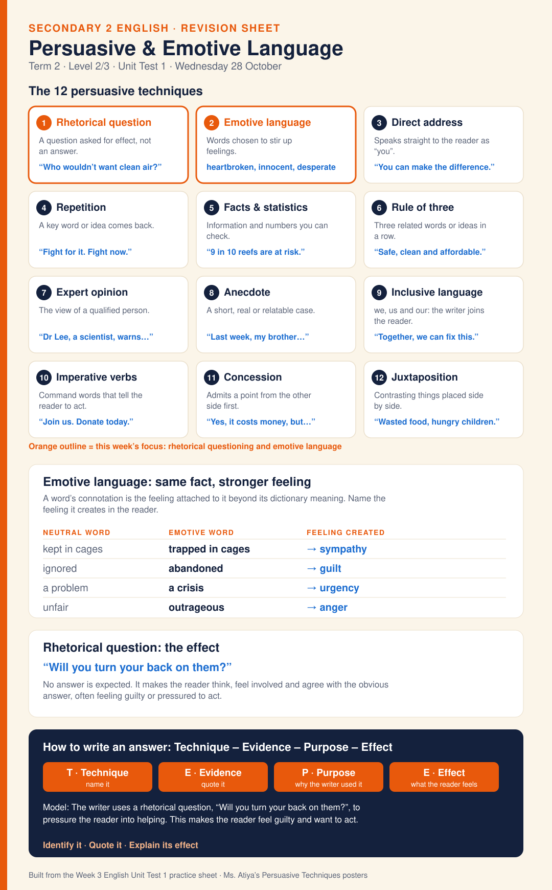

# Secondary 2 · English Revision Sheets

One-page revision sheets for English topics, in the same style as the [science formula sheets](../science-formula-sheets/README.md). Each sheet is an SVG for GitHub and print, with a short caption page.

| # | Sheet | Term | Page | Image |
|---|-------|------|------|-------|
| 1 | **Persuasive & Emotive Language** | T2 · Unit Test 1 | [english-sheet-1-persuasive-emotive-language.md](english-sheet-1-persuasive-emotive-language.md) | [.svg](svg/english-sheet-1-persuasive-emotive-language.svg) |
| 2 | **Semicolon Usage** | T1 · Unit 1 (Section C) | [english-sheet-2-semicolon-usage.md](english-sheet-2-semicolon-usage.md) | [.svg](svg/english-sheet-2-semicolon-usage.svg) |

