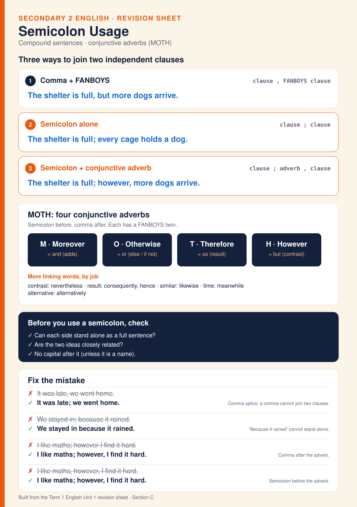

# English Sheet 2 · Semicolon Usage

One-page summary of semicolon usage. Two independent clauses can be joined three ways: a comma plus a FANBOYS word ("The shelter is full, but more dogs arrive."), a semicolon alone when the ideas are closely related ("The shelter is full; every cage holds a dog."), or a semicolon plus a conjunctive adverb with a comma after it ("The shelter is full; however, more dogs arrive."). MOTH gives four conjunctive adverbs, each with a FANBOYS twin: Moreover (and), Otherwise (or), Therefore (so), However (but). Before using a semicolon, check that each side can stand alone as a sentence and that the ideas are closely related. Common mistakes: a comma splice, a semicolon before a dependent clause, a missing comma after the adverb, and a comma instead of a semicolon before the adverb.

**Built from:** [Term 1 English Unit 1 revision sheet · Section C](../t1/term1-english-unit1-revision.md)

**Image:** [SVG](svg/english-sheet-2-semicolon-usage.svg)

**Practise:** [Semicolon Practice Test](english-test-semicolon-practice.md)

[← All English revision sheets](README.md)
