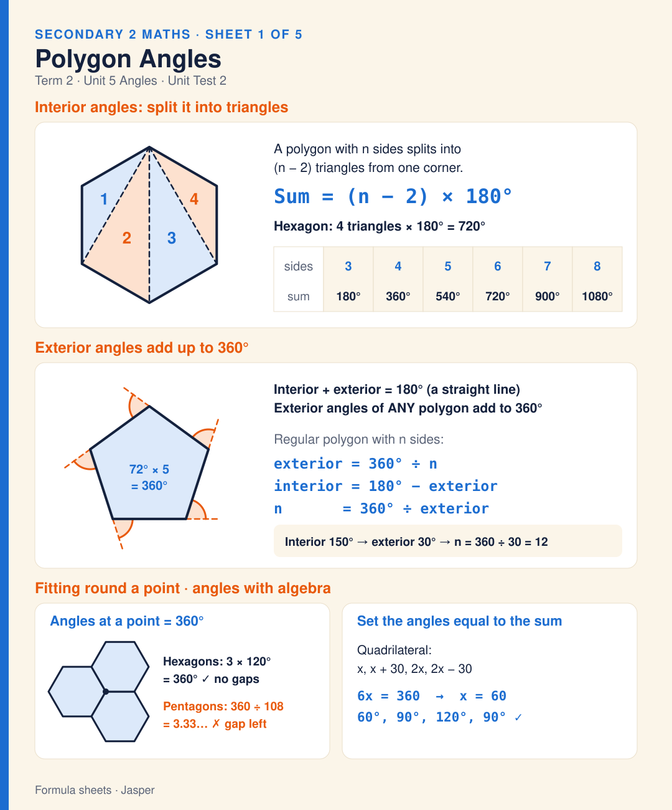
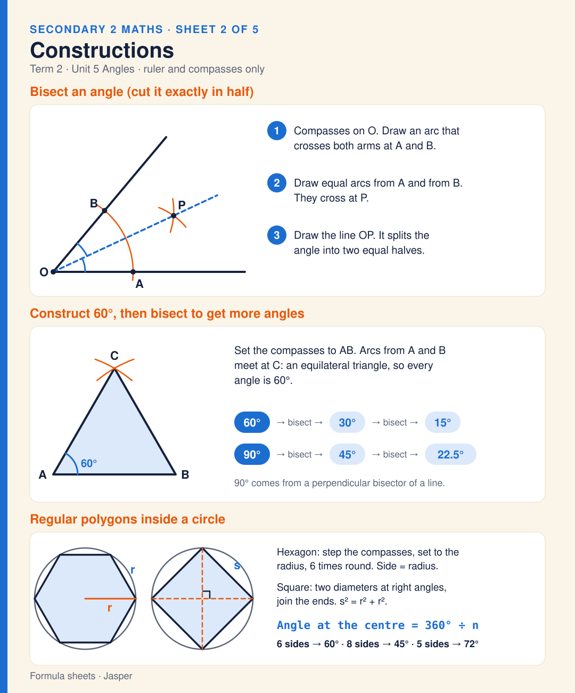
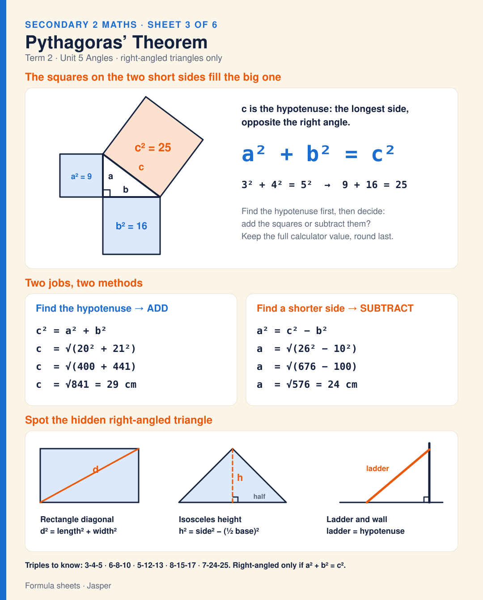
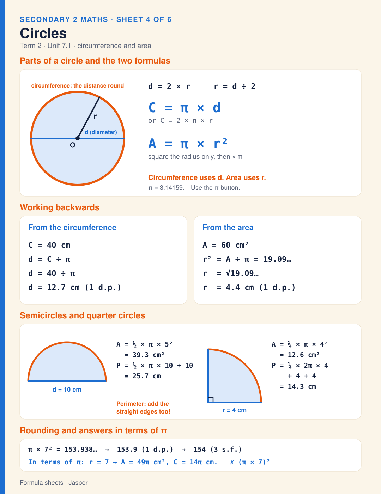
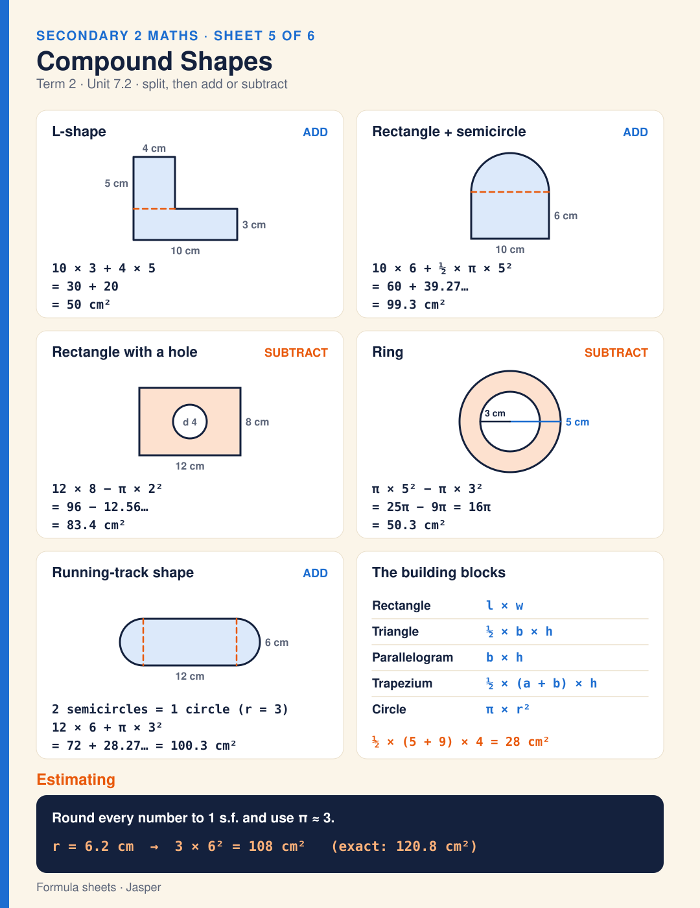
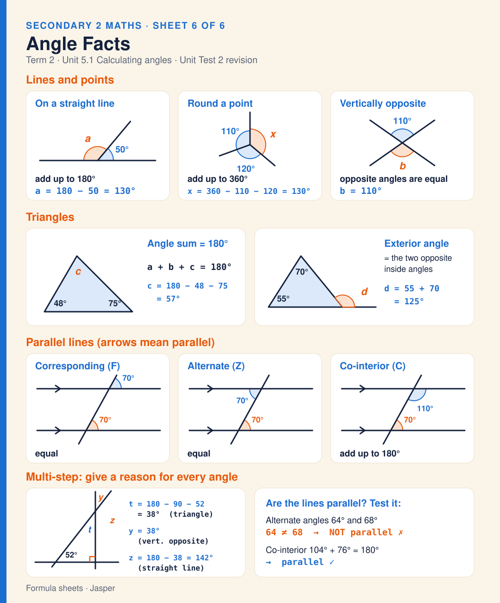
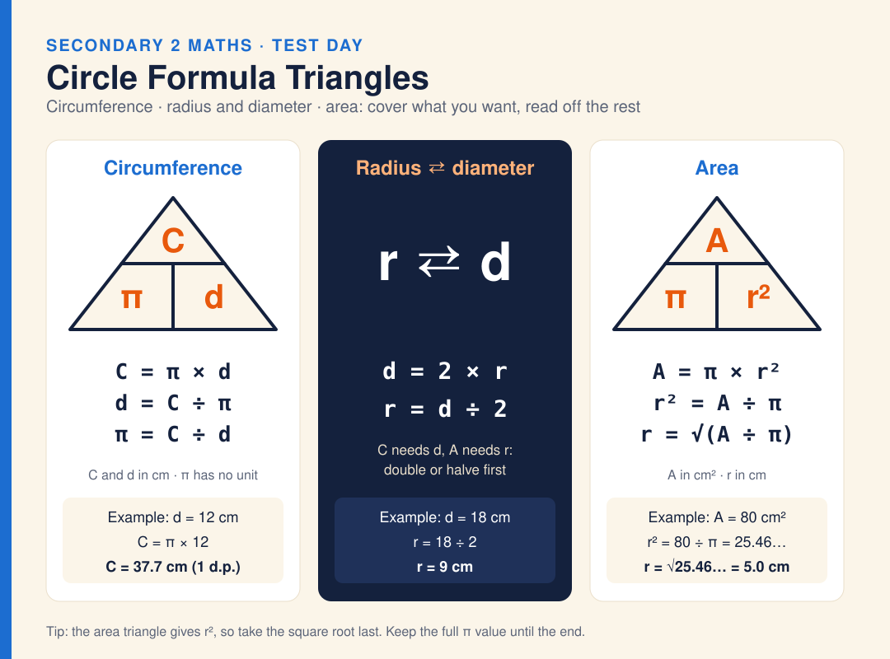
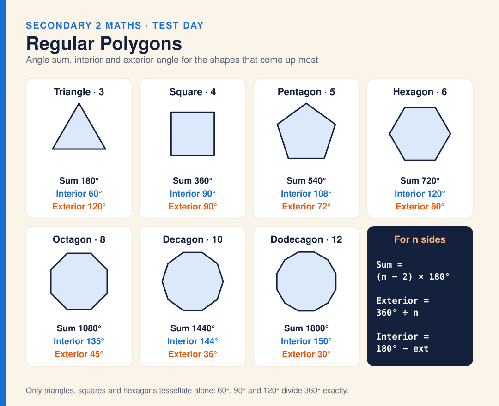

# Secondary 2 · Maths Formula Sheets

One-page formula and key-fact sheets for the Term 2 **Maths Unit Test 2** (Angles, Shapes & Measurements: Stage 9 Unit 5 and Unit 7.1–7.2). Sheet 6 goes back to Unit 5.1 angle facts for revision. Each sheet is an SVG for GitHub and print, with a short caption. WhatsApp JPGs are made locally from the SVGs and are not committed (see `.gitignore`). Two extra diagrams cover the circle formula triangles and the angles of the common regular polygons. The worked examples use different numbers from the practice sheet, so they don't give its answers away.

| # | Sheet | Unit | Page | Image |
|---|-------|------|------|-------|
| 1 | **Polygon Angles** | 5 · Angles | [maths-sheet-1-polygon-angles.md](maths-sheet-1-polygon-angles.md) | [.svg](svg/maths-sheet-1-polygon-angles.svg) |
| 2 | **Constructions** | 5 · Angles | [maths-sheet-2-constructions.md](maths-sheet-2-constructions.md) | [.svg](svg/maths-sheet-2-constructions.svg) |
| 3 | **Pythagoras’ Theorem** | 5 · Angles | [maths-sheet-3-pythagoras.md](maths-sheet-3-pythagoras.md) | [.svg](svg/maths-sheet-3-pythagoras.svg) |
| 4 | **Circles** | 7.1 · Shapes & measurements | [maths-sheet-4-circles.md](maths-sheet-4-circles.md) | [.svg](svg/maths-sheet-4-circles.svg) |
| 5 | **Compound Shapes** | 7.2 · Shapes & measurements | [maths-sheet-5-compound-shapes.md](maths-sheet-5-compound-shapes.md) | [.svg](svg/maths-sheet-5-compound-shapes.svg) |
| 6 | **Angle Facts** | 5.1 · Angles (revision) | [maths-sheet-6-angle-facts.md](maths-sheet-6-angle-facts.md) | [.svg](svg/maths-sheet-6-angle-facts.svg) |

## Previews

### 1. Polygon Angles

[](maths-sheet-1-polygon-angles.md)

### 2. Constructions

[](maths-sheet-2-constructions.md)

### 3. Pythagoras’ Theorem

[](maths-sheet-3-pythagoras.md)

### 4. Circles

[](maths-sheet-4-circles.md)

### 5. Compound Shapes

[](maths-sheet-5-compound-shapes.md)

### 6. Angle Facts

[](maths-sheet-6-angle-facts.md)

## Diagrams

| Diagram | Page | Image |
|---------|------|-------|
| **Circle Formula Triangles** — circumference, radius ⇄ diameter, area (with r = √(A ÷ π)), with worked examples | [maths-diagram-circle-formula-triangles.md](maths-diagram-circle-formula-triangles.md) | [.svg](svg/maths-diagram-circle-formula-triangles.svg) |
| **Regular Polygons** — angle sum, interior and exterior angle for 3, 4, 5, 6, 8, 10 and 12 sides | [maths-diagram-regular-polygons.md](maths-diagram-regular-polygons.md) | [.svg](svg/maths-diagram-regular-polygons.svg) |

[](maths-diagram-circle-formula-triangles.md)

[](maths-diagram-regular-polygons.md)

## Other files

- [index.html](index.html) — browser gallery of every sheet and diagram with captions (the home-page card links here).
- [whatsapp/captions-whatsapp.txt](whatsapp/captions-whatsapp.txt) — all captions in one file, ready to paste. The matching JPGs live in `whatsapp/` locally but are git-ignored.

## Folder layout

```
maths-formula-sheets/
├── index.html              ← Browser gallery of all sheets (linked from the home page)
├── README.md               ← This file
├── maths-sheet-N-*.md      ← One page per sheet: image + caption + source worksheets
├── maths-diagram-*.md      ← Circle formula triangles and regular polygons diagrams
├── svg/                    ← Sheet images (SVG)
└── whatsapp/               ← captions-whatsapp.txt + *.cap.txt (JPGs here are git-ignored)
```
