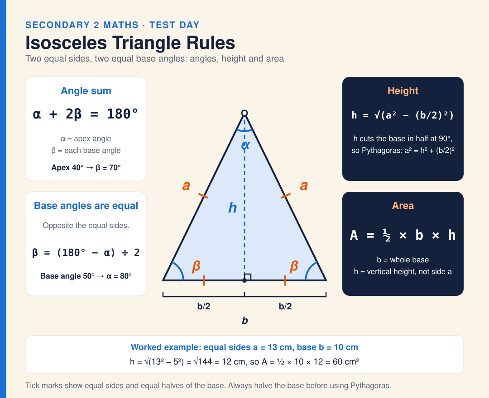

# Diagram · Isosceles Triangle Rules

Isosceles triangle rules. Two equal sides a and two equal base angles β. Angle sum: α + 2β = 180°, so β = (180° − α) ÷ 2 (apex 40° gives β = 70°; base angle 50° gives α = 80°). The height h cuts the base in half at 90°, so by Pythagoras h = √(a² − (b/2)²). Area = ½ × b × h, using the whole base b and the vertical height, not the slanted side. Worked example: a = 13 cm, b = 10 cm gives h = √(13² − 5²) = 12 cm and A = ½ × 10 × 12 = 60 cm².

**Built from:** [Week 5 · Maths Unit Test 2 Practice](../t2/w5/term2-week5-maths-unit-test2-angles-shapes-measurements.md)

**Image:** [SVG](svg/maths-diagram-isosceles-triangle.svg)

[← All formula sheets](README.md)
