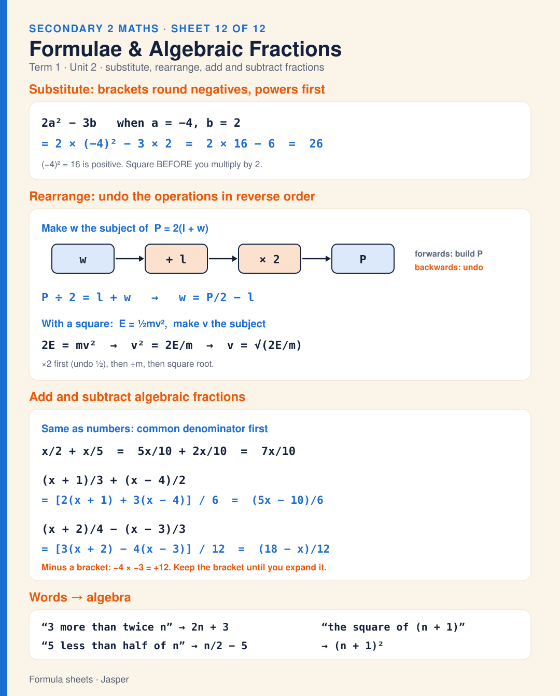

# Sheet 12 · Formulae & Algebraic Fractions

Formulae and algebraic fractions (Unit 2). Substitute with brackets round negatives and powers first: 2a² − 3b with a = −4, b = 2 gives 2 × 16 − 6 = 26. Rearrange by undoing the operations in reverse order: P = 2(l + w) gives w = P/2 − l; E = ½mv² gives v = √(2E/m). Add or subtract algebraic fractions over a common denominator: x/2 + x/5 = 7x/10; (x + 1)/3 + (x − 4)/2 = (5x − 10)/6; (x + 2)/4 − (x − 3)/3 = (18 − x)/12, where minus a bracket changes both signs. Words to algebra: “3 more than twice n” is 2n + 3, “5 less than half of n” is n/2 − 5, “the square of (n + 1)” is (n + 1)².

**Built from:** [Week 5 · Expressions & Formulae](../t1/w5/term1-week5-maths-expressions-formulae.md)

**Image:** [SVG](svg/maths-sheet-12-formulae-algebraic-fractions.svg)

[← All formula sheets](README.md)
