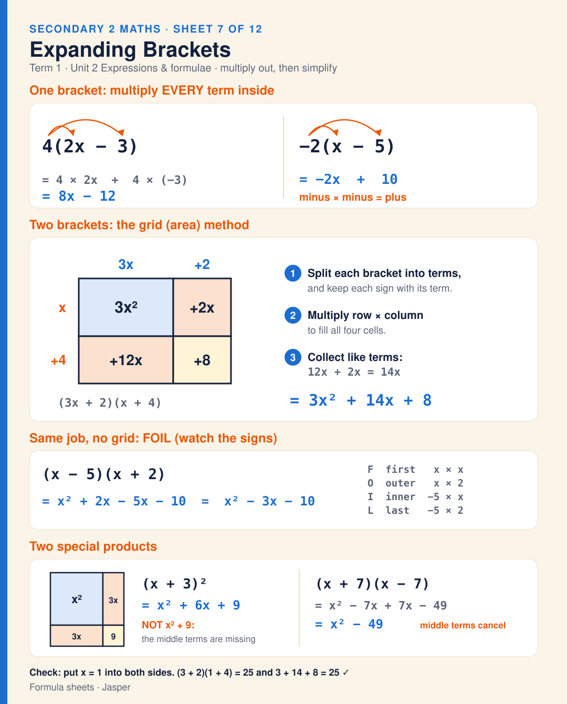

# Sheet 7 · Expanding Brackets

Expanding brackets (Unit 2). One bracket: multiply every term inside, 4(2x − 3) = 8x − 12, and −2(x − 5) = −2x + 10 because minus × minus = plus. Two brackets with the grid (area) method: split each bracket into terms with their signs, multiply row × column, then collect like terms, so (3x + 2)(x + 4) = 3x² + 12x + 2x + 8 = 3x² + 14x + 8. FOIL does the same job: (x − 5)(x + 2) = x² + 2x − 5x − 10 = x² − 3x − 10. Special products: (x + 3)² = x² + 6x + 9, not x² + 9; (x + 7)(x − 7) = x² − 49 because the middle terms cancel. Check by putting x = 1 into both sides.

**Built from:** [Week 5 · Expressions & Formulae](../t1/w5/term1-week5-maths-expressions-formulae.md)

**Image:** [SVG](svg/maths-sheet-7-expanding-brackets.svg)

[← All formula sheets](README.md)
