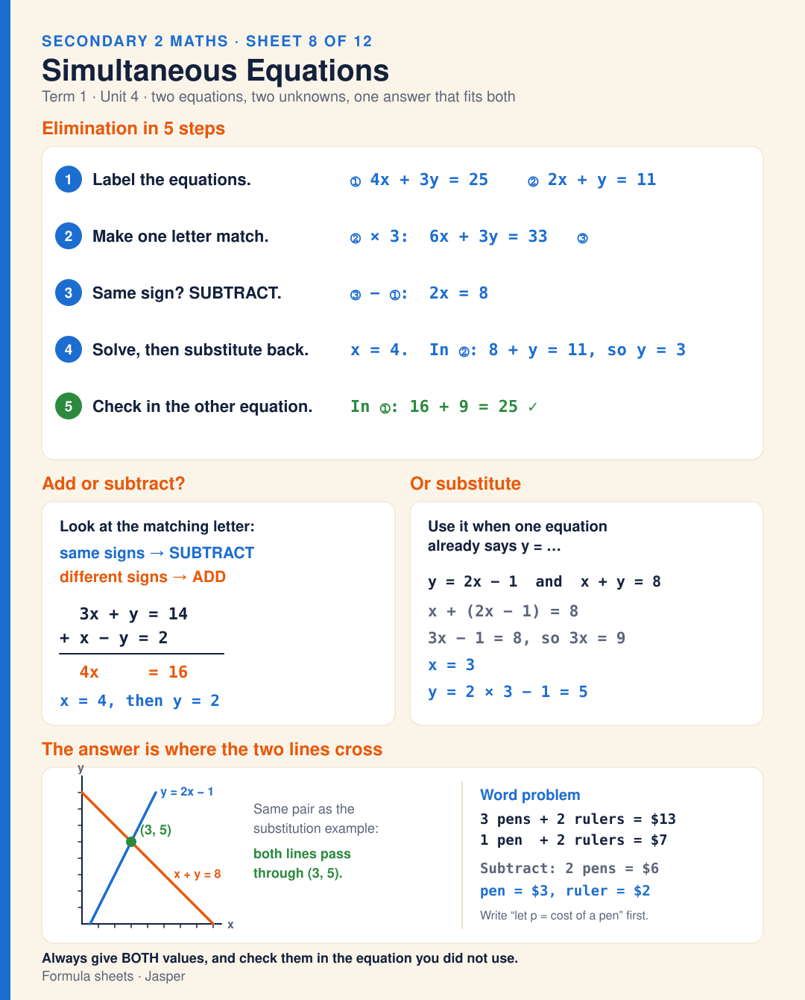

# Sheet 8 · Simultaneous Equations

Simultaneous equations (Unit 4). Elimination in 5 steps: label the equations (4x + 3y = 25 and 2x + y = 11); make one letter match (× 3 gives 6x + 3y = 33); same signs subtract, different signs add (2x = 8); solve and substitute back (x = 4, y = 3); check in the other equation (16 + 9 = 25). Adding: 3x + y = 14 and x − y = 2 give 4x = 16, so x = 4 and y = 2. Substitution when one equation says y = …: y = 2x − 1 and x + y = 8 give 3x − 1 = 8, so x = 3 and y = 5. On a graph, the answer is where the two lines cross, at (3, 5). Word problem: 3 pens + 2 rulers = $13 and 1 pen + 2 rulers = $7, so a pen costs $3 and a ruler $2. Always give both values.

**Built from:** [Week 8 · Simultaneous Equations](../t1/w8/term1-week8-maths-unit4-simultaneous-equations.md)

**Image:** [SVG](svg/maths-sheet-8-simultaneous-equations.svg)

[← All formula sheets](README.md)
