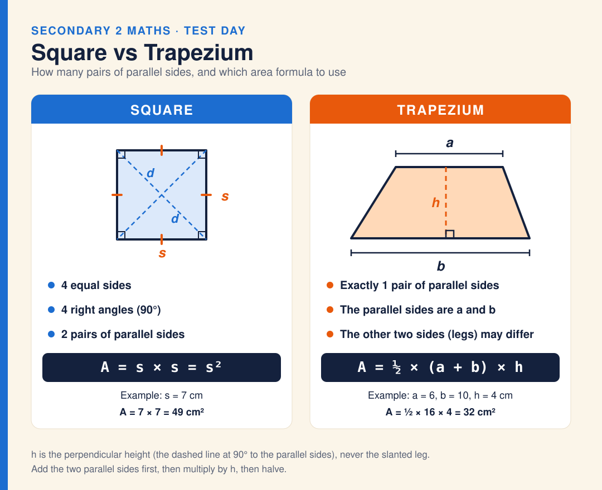

# Diagram · Square vs Trapezium

Square versus trapezium. A square has 4 equal sides, 4 right angles and 2 pairs of parallel sides: A = s × s (s = 7 cm gives 49 cm²). A trapezium has exactly 1 pair of parallel sides, a and b, and its other two sides (legs) may differ: A = ½ × (a + b) × h, where h is the perpendicular height, never the slanted leg (a = 6, b = 10, h = 4 gives ½ × 16 × 4 = 32 cm²). Add the parallel sides first, then multiply by h, then halve.

**Built from:** [Week 5 · Maths Unit Test 2 Practice](../../sem1/t2/w5/term2-week5-maths-unit-test2-angles-shapes-measurements.md)

**Image:** [SVG](svg/maths-diagram-square-vs-trapezium.svg)

[← All formula sheets](README.md)
