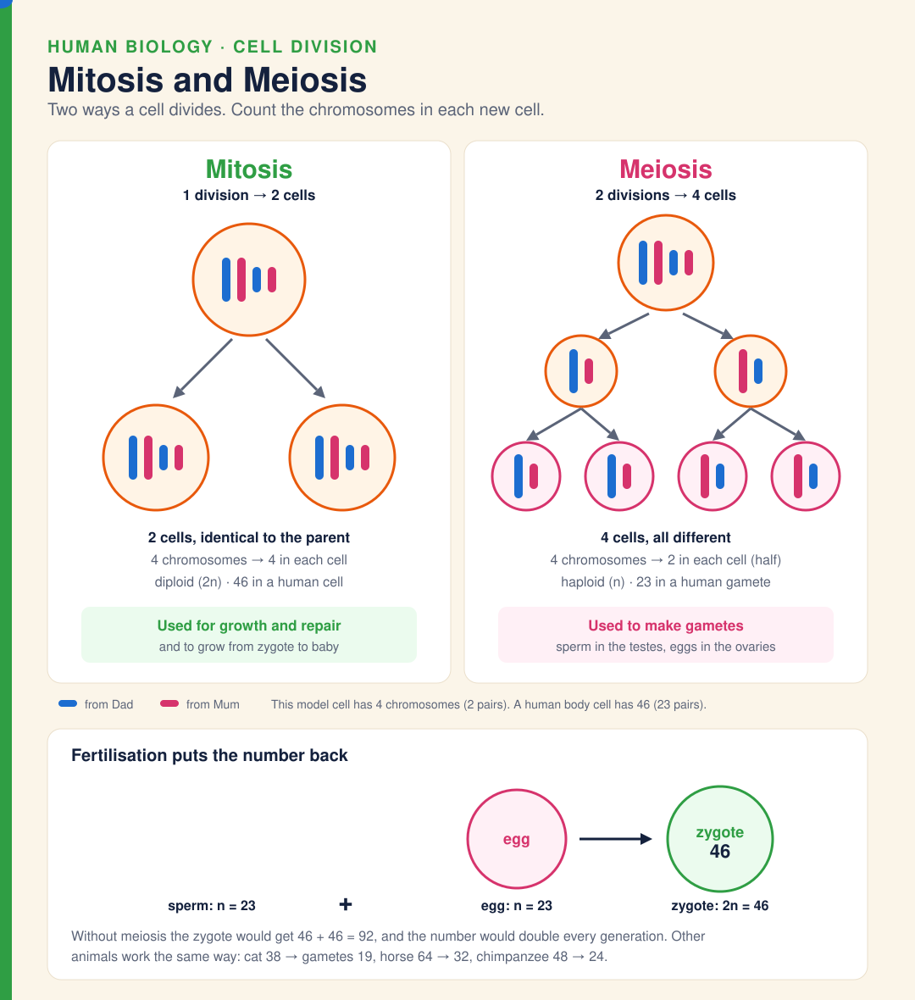

# Diagram · Mitosis and Meiosis

Two ways a cell divides, shown with a model cell of 4 chromosomes (a human body cell has 46). Mitosis: 1 division gives 2 cells, identical to the parent, each with the full number (diploid, 2n, 46 in humans). It is used for growth and repair. Meiosis: 2 divisions give 4 cells, all different, each with half the number (haploid, n, 23 in humans). It makes the gametes: sperm in the testes and eggs in the ovaries. At fertilisation a sperm (23) and an egg (23) join to make a zygote (46). Without meiosis the number would double every generation (46 + 46 = 92). Other animals: cat 38 → 19, horse 64 → 32, chimpanzee 48 → 24.

The new cells appear one division at a time and a sperm swims to the egg when the SVG is opened in a browser; the WhatsApp JPG is a still.

**Built from:** [Week 7 · Science Unit Test: Electricity + Human Biology](../../sem1/t2/w7/term2-week7-science-unit-test-electricity-human-biology.md)

**Image:** [SVG](svg/science-diagram-mitosis-meiosis.svg) · **Human Biology only:** [human-biology.html](human-biology.html)
