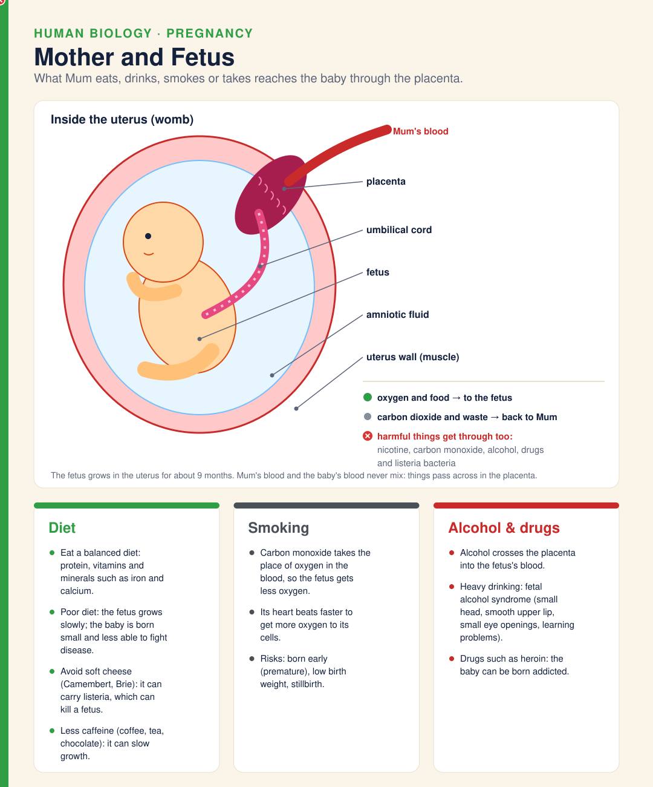

# Diagram · Mother and Fetus

The fetus grows in the uterus (womb) for about 9 months, inside the amniotic fluid. The umbilical cord joins it to the placenta, where substances pass between Mum's blood and the baby's blood without the two mixing. Oxygen and food go to the fetus; carbon dioxide and waste go back to Mum. Harmful things get through too: nicotine, carbon monoxide, alcohol, drugs and listeria bacteria. Diet: eat a balanced diet; a poor diet means the fetus grows slowly and the baby is born small and less able to fight disease; avoid soft cheese (listeria) and cut down on caffeine. Smoking: carbon monoxide means less oxygen, the fetus's heart beats faster, and the baby may be premature, have a low birth weight or be stillborn. Alcohol and drugs: heavy drinking can cause fetal alcohol syndrome (small head, smooth upper lip, small eye openings); a baby can be born addicted to drugs.

Oxygen, food, waste and harmful substances move along the cord when the SVG is opened in a browser; the WhatsApp JPG is a still.

**Built from:** [Week 7 · Science Unit Test: Electricity + Human Biology](../../sem1/t2/w7/term2-week7-science-unit-test-electricity-human-biology.md)

**Image:** [SVG](svg/science-diagram-mother-fetus.svg) · **Human Biology only:** [human-biology.html](human-biology.html)
