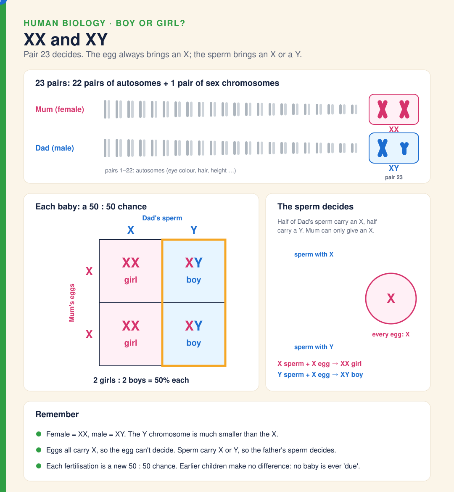

# Diagram · XX and XY: Boy or Girl?

Boy or girl? Humans have 23 pairs of chromosomes: 22 pairs of autosomes and 1 pair of sex chromosomes. Females are XX and males are XY; the Y is much smaller than the X. Every egg carries an X. Half of the sperm carry an X and half carry a Y, so the father's sperm decides. X sperm + X egg gives XX, a girl; Y sperm + X egg gives XY, a boy. The 2 × 2 grid gives 2 girls and 2 boys, a 50% chance of each. Every fertilisation is a new 50 : 50 chance, whatever earlier children were.

The sperm swim to the egg and the Y column glows when the SVG is opened in a browser; the WhatsApp JPG is a still.

**Built from:** [Week 7 · Science Unit Test: Electricity + Human Biology](../../sem1/t2/w7/term2-week7-science-unit-test-electricity-human-biology.md)

**Image:** [SVG](svg/science-diagram-xx-xy.svg) · **Human Biology only:** [human-biology.html](human-biology.html)
