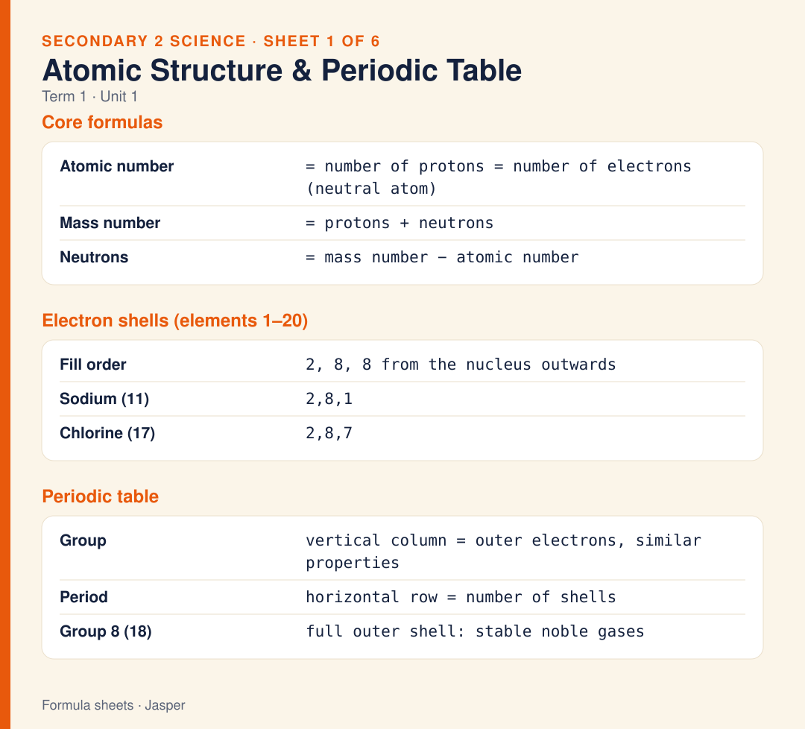
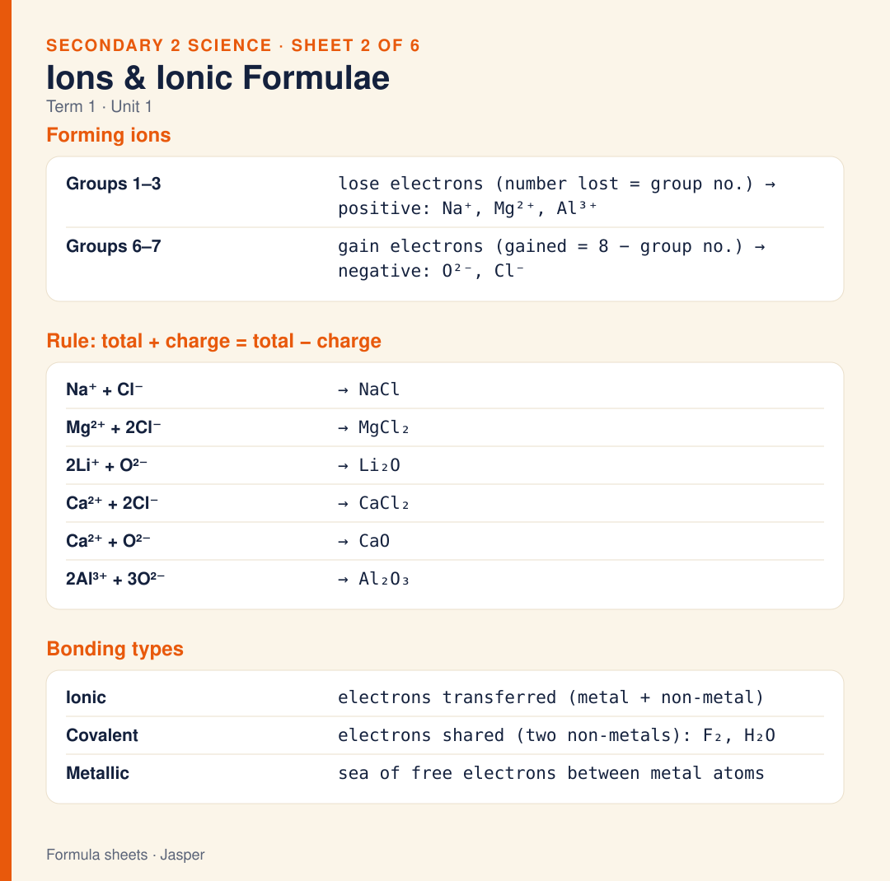
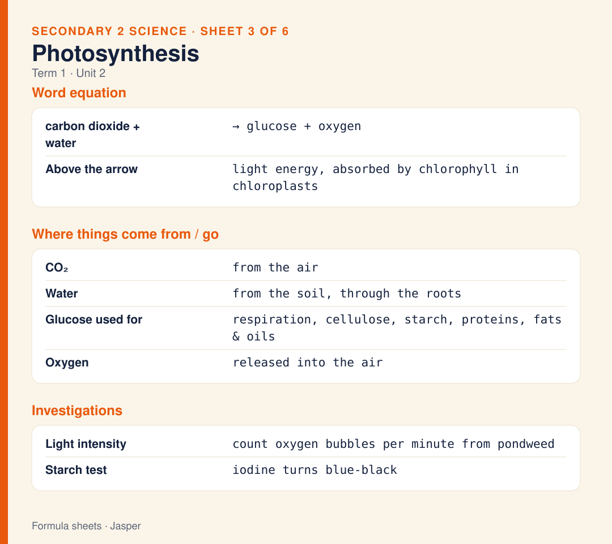
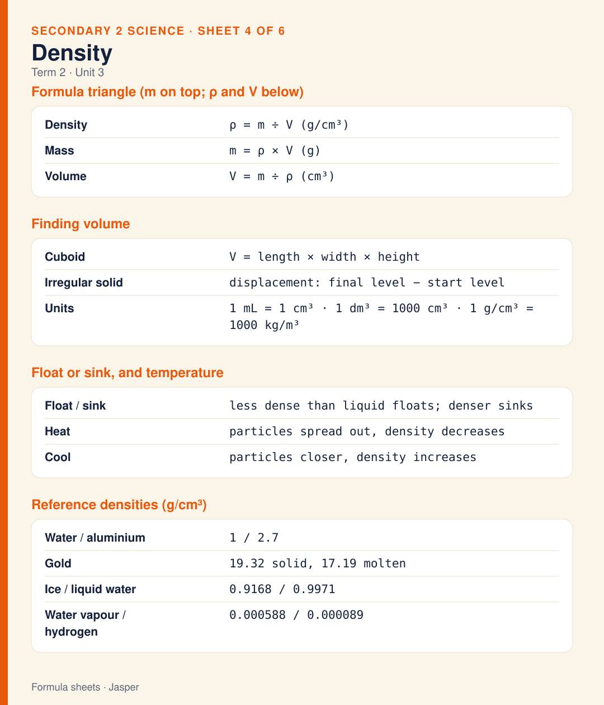
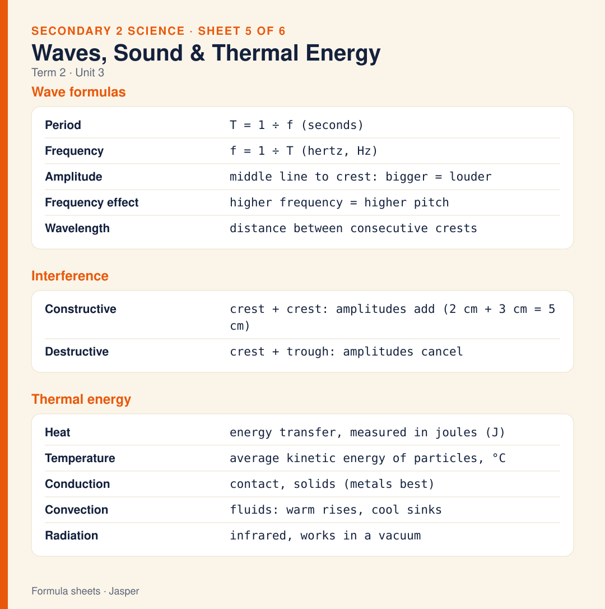
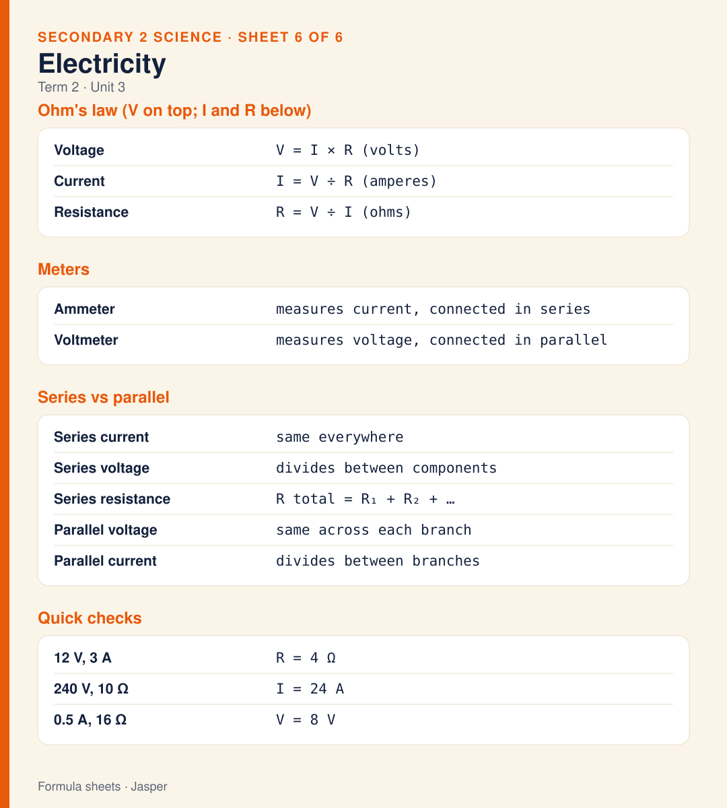
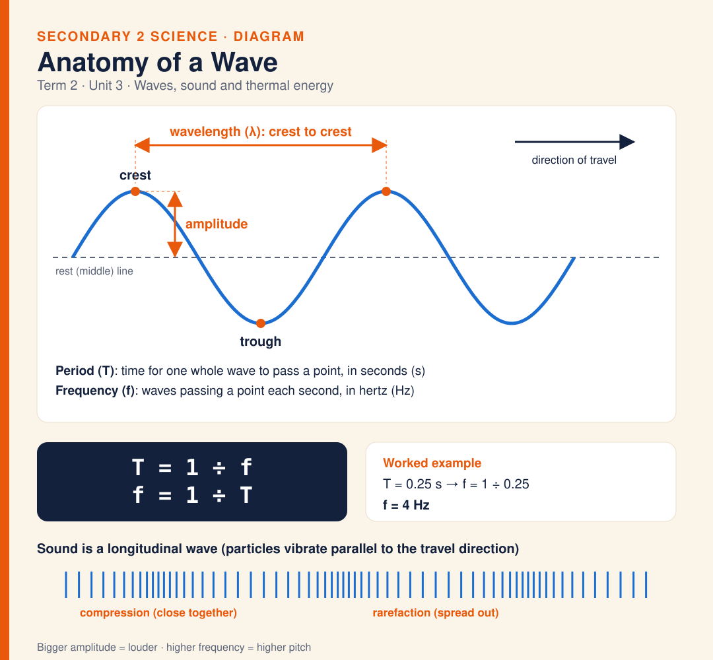
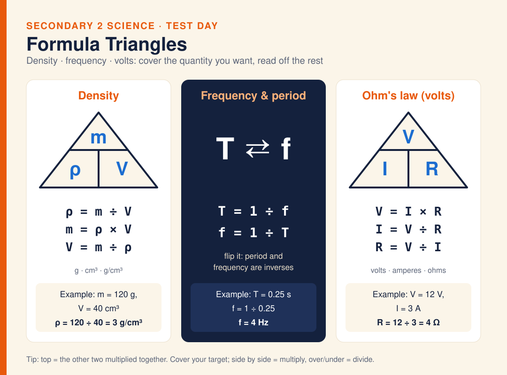

# Secondary 2 · Science Formula Sheets

One-page formula and key-fact sheets for every science topic covered so far (Term 1 Units 1–2, Term 2 Unit 3). Each sheet is an SVG for GitHub and print, with a short explanatory caption. WhatsApp JPGs are made locally from the SVGs and are not committed (see `.gitignore`). Two extra diagrams cover the anatomy of a wave and the formula triangles.

| # | Sheet | Term | Page | Image |
|---|-------|------|------|-------|
| 1 | **Atomic Structure & Periodic Table** | T1 · Unit 1 | [science-sheet-1-atomic-structure-periodic-table.md](science-sheet-1-atomic-structure-periodic-table.md) | [.svg](svg/science-sheet-1-atomic-structure-periodic-table.svg) |
| 2 | **Ions & Ionic Formulae** | T1 · Unit 1 | [science-sheet-2-ions-ionic-formulae.md](science-sheet-2-ions-ionic-formulae.md) | [.svg](svg/science-sheet-2-ions-ionic-formulae.svg) |
| 3 | **Photosynthesis** | T1 · Unit 2 | [science-sheet-3-photosynthesis.md](science-sheet-3-photosynthesis.md) | [.svg](svg/science-sheet-3-photosynthesis.svg) |
| 4 | **Density** | T2 · Unit 3 | [science-sheet-4-density.md](science-sheet-4-density.md) | [.svg](svg/science-sheet-4-density.svg) |
| 5 | **Waves, Sound & Thermal Energy** | T2 · Unit 3 | [science-sheet-5-waves-sound-thermal-energy.md](science-sheet-5-waves-sound-thermal-energy.md) | [.svg](svg/science-sheet-5-waves-sound-thermal-energy.svg) |
| 6 | **Electricity** | T2 · Unit 3 | [science-sheet-6-electricity.md](science-sheet-6-electricity.md) | [.svg](svg/science-sheet-6-electricity.svg) |

## Previews

### 1. Atomic Structure & Periodic Table

[](science-sheet-1-atomic-structure-periodic-table.md)

### 2. Ions & Ionic Formulae

[](science-sheet-2-ions-ionic-formulae.md)

### 3. Photosynthesis

[](science-sheet-3-photosynthesis.md)

### 4. Density

[](science-sheet-4-density.md)

### 5. Waves, Sound & Thermal Energy

[](science-sheet-5-waves-sound-thermal-energy.md)

### 6. Electricity

[](science-sheet-6-electricity.md)

## Diagrams

| Diagram | Page | Image |
|---------|------|-------|
| **Anatomy of a Wave** — amplitude, wavelength, crest, trough, period, frequency, compressions | [science-diagram-waves.md](science-diagram-waves.md) | [.svg](svg/science-diagram-waves.svg) |
| **Formula Triangles** — density, Ohm's law, period and frequency | [science-diagram-formula-triangles.md](science-diagram-formula-triangles.md) | [.svg](svg/science-diagram-formula-triangles.svg) |

[](science-diagram-waves.md)

[](science-diagram-formula-triangles.md)

## Other files

- [index.html](index.html) — browser gallery of every sheet and diagram with captions (the home-page card links here).
- [formula-reference.md](formula-reference.md) — all six sheets as one text document (tables, copy-friendly).
- [whatsapp/captions-whatsapp.txt](whatsapp/captions-whatsapp.txt) — all captions in one file, ready to paste. The matching JPGs live in `whatsapp/` locally but are git-ignored.

## Folder layout

```
science-formula-sheets/
├── index.html                ← Browser gallery of all sheets (linked from the home page)
├── README.md                 ← This file
├── formula-reference.md      ← Text version of all six sheets
├── science-sheet-N-*.md      ← One page per sheet: image + caption + source worksheets
├── science-diagram-*.md      ← Wave anatomy and formula-triangle diagrams
├── svg/                      ← Sheet images (SVG)
└── whatsapp/                 ← captions-whatsapp.txt (JPGs here are git-ignored)
```
