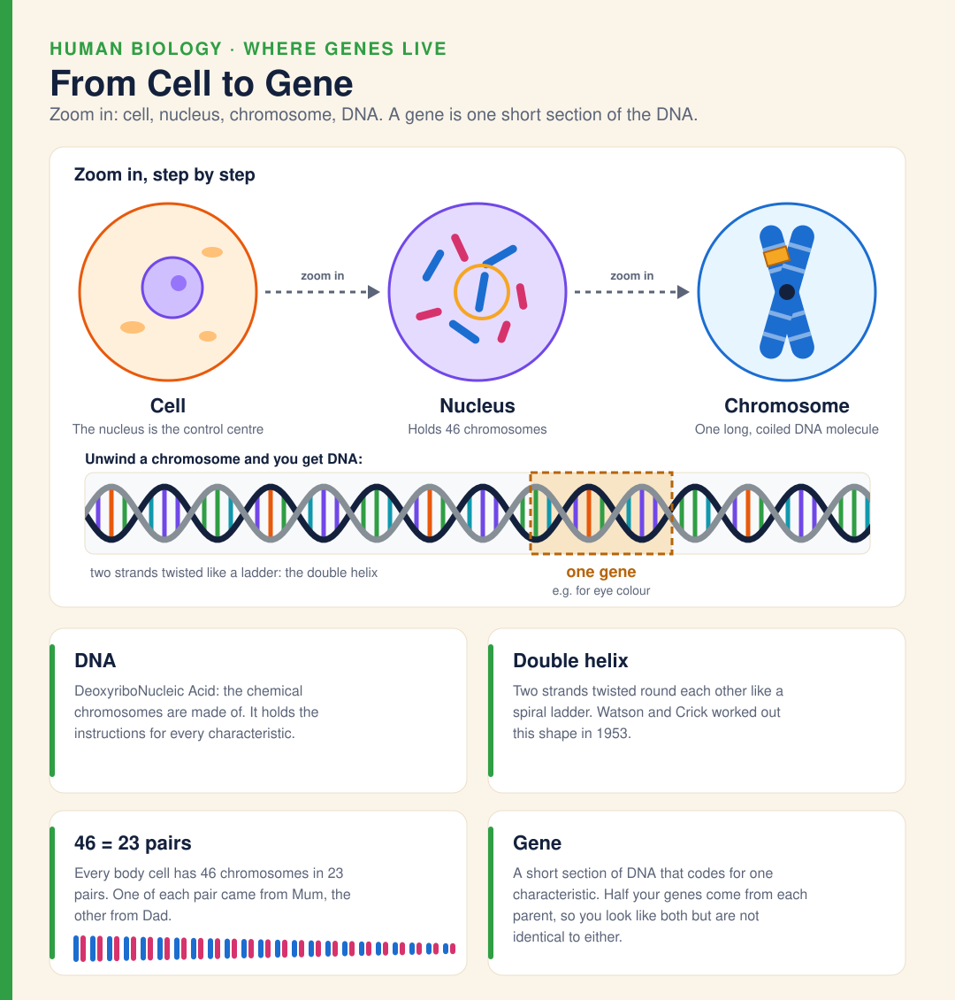

# Diagram · From Cell to Gene

Zoom in from a cell to a gene. The nucleus is the control centre of the cell and holds 46 chromosomes. Each chromosome is one long, coiled molecule of DNA (deoxyribonucleic acid). DNA is a double helix: two strands twisted like a spiral ladder, a shape worked out by Watson and Crick in 1953. A gene is a short section of DNA that codes for one characteristic, such as eye colour. Every body cell has 46 chromosomes in 23 pairs: one of each pair comes from Mum and the other from Dad, so you look like both parents but are not identical to either.

The DNA helix turns and the gene glows when the SVG is opened in a browser; the WhatsApp JPG is a still.

**Built from:** [Week 7 · Science Unit Test: Electricity + Human Biology](../t2/w7/term2-week7-science-unit-test-electricity-human-biology.md)

**Image:** [SVG](svg/science-diagram-cell-to-gene.svg) · **Human Biology only:** [human-biology.html](human-biology.html)
