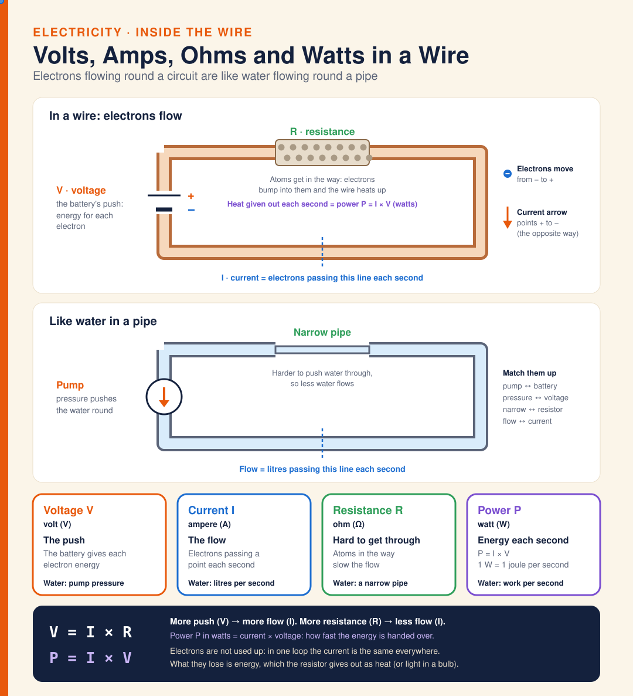

# Diagram · Volts, Amps, Ohms and Watts in a Wire

Volts, amps, ohms and watts in a wire, side by side with water in a pipe. The battery is like a pump: voltage V (volts) is the push that gives each electron energy. Current I (amps) is how many electrons pass a point each second, like litres of water per second. Resistance R (ohms) is how hard it is to get through: atoms in the resistor get in the way, like a narrow pipe, and the wire heats up. Power P (watts) = I × V is the energy handed over each second. Electrons move from − to +, while the current arrow points + to −. Electrons are not used up: in one loop the current is the same everywhere; what they lose is energy. V = I × R and P = I × V.

The electrons and the water move when the SVG is opened in a browser; the WhatsApp JPG is a still.

**Built from:** [Week 4 · Electricity](../t2/w4/term2-week4-science-unit3-electricity.md)

**Image:** [SVG](svg/science-diagram-electron-flow.svg) · **Electricity only:** [electricity.html](electricity.html)

[← All formula sheets](README.md)
