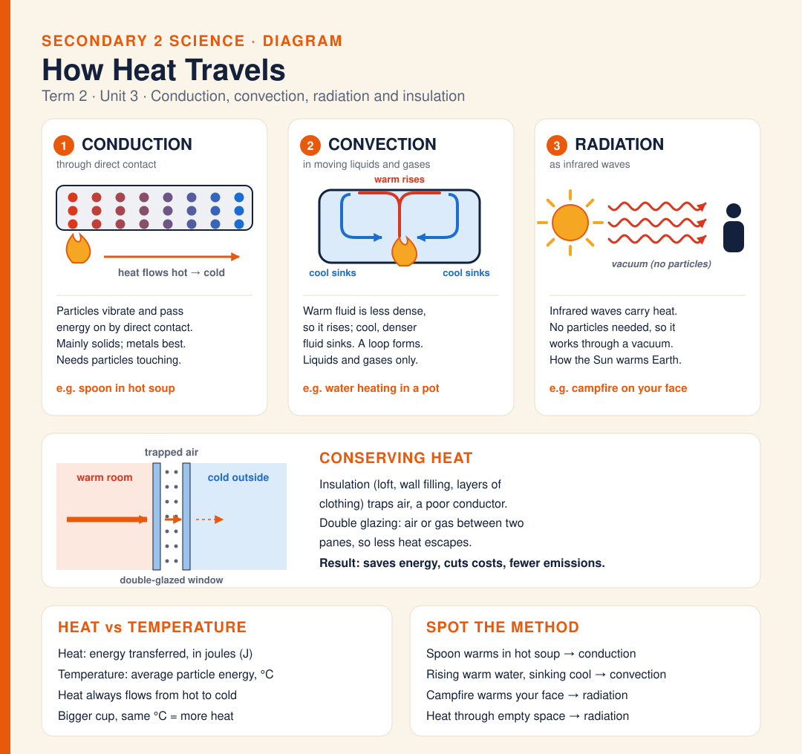

# Diagram · How Heat Travels

How heat travels. Conduction: particles vibrate and pass energy on by direct contact, mainly in solids (metals best), so a spoon warms in hot soup. Convection: warm fluid is less dense and rises while cool, denser fluid sinks, making a loop in liquids and gases. Radiation: infrared waves carry heat and need no particles, so it works through a vacuum (the Sun, a campfire). Insulation and double glazing trap air, a poor conductor, so less heat escapes. Heat (joules) flows from hot to cold; temperature (°C) is the average particle energy.

**Built from:** [Week 4 · Sound Waves & Thermal Energy](../t2/w4/term2-week4-science-unit3-sound-thermal-energy.md) (Section E)

**Image:** [SVG](svg/science-diagram-heat-transfer.svg)

[← All formula sheets](README.md)
