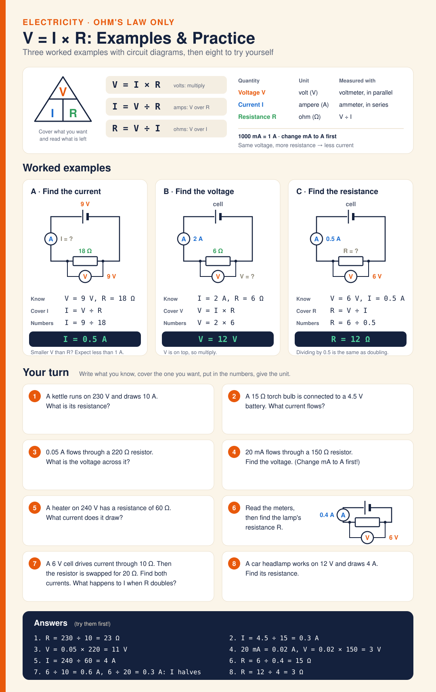

# Diagram · V = I × R: Examples & Practice

Ohm's law only, no transformer. A key box with the formula triangle, the three forms (V = I × R, I = V ÷ R, R = V ÷ I), units and meters. Three worked examples with circuit diagrams: 9 V across 18 Ω gives 0.5 A; 2 A through 6 Ω gives 12 V; 6 V and 0.5 A give 12 Ω. Then eight questions to try (kettle, torch bulb, mA to A, reading meters off a circuit, what happens when R doubles), with answers and working at the bottom.

**Answers:** 1. 23 Ω · 2. 0.3 A · 3. 11 V · 4. 3 V · 5. 4 A · 6. 15 Ω · 7. 0.6 A then 0.3 A (doubling R halves I) · 8. 3 Ω

**Built from:** [Week 4 · Electricity](../t2/w4/term2-week4-science-unit3-electricity.md)

**Image:** [SVG](svg/science-diagram-ohms-law-practice.svg) · **Electricity only:** [electricity.html](electricity.html)

[← All formula sheets](README.md)
