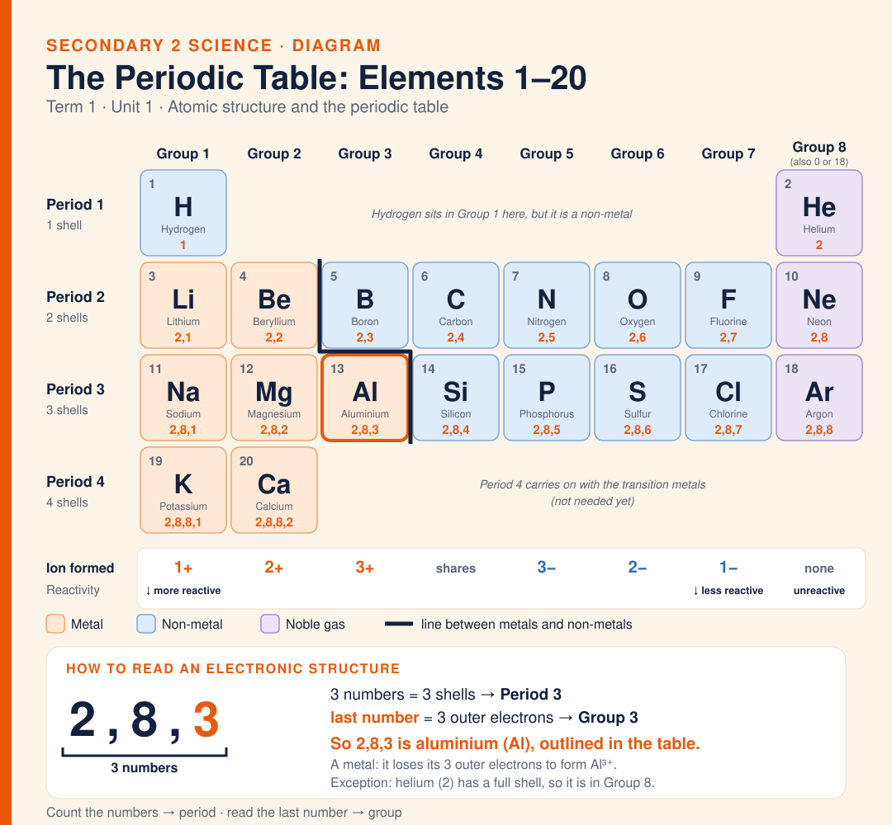

# Diagram · The Periodic Table (Elements 1–20)

The periodic table for elements 1–20. Each box shows the atomic number, symbol, name and electronic structure. Groups are columns: the group number is the number of outer electrons, which is the last number in the structure. Periods are rows: the period number is the number of shells, which is how many numbers there are. Example: 2,8,3 has three numbers, so Period 3, and ends in 3, so Group 3: aluminium. Metals (orange) sit left of the staircase line and lose electrons to form positive ions; non-metals (blue) gain or share electrons. Group 8 (also called Group 0 or 18) holds the noble gases, with a full outer shell.

**Built from:** [Week 2 · Atomic Structure & Periodic Table](../t1/w2/term1-week2-atomic-structure-periodic.html) · [Week 3 · Why Elements React & Ionic Bonding](../t1/w3/term1-week3-science-ionic-bonding.md)

**Image:** [SVG](svg/science-diagram-periodic-table.svg)

[← All formula sheets](README.md)
