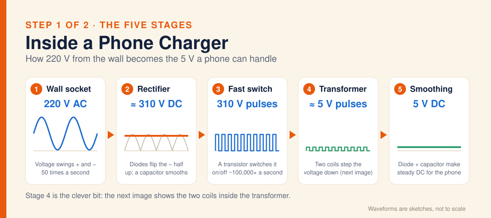

# Diagram · Phone Charger: The Five Stages

Inside a phone charger, step 1: the five stages. The wall gives 220 V AC that swings + and − 50 times a second. A rectifier (diodes) flips the − half up and a capacitor smooths it to about 310 V DC. A transistor switches that on and off about 100,000 times a second, making 310 V pulses. A transformer steps them down to about 5 V pulses, then a diode and capacitor smooth them into steady 5 V DC for the phone.

**Built from:** [Week 4 · Electricity](../t2/w4/term2-week4-science-unit3-electricity.md)

**Image:** [SVG](svg/science-diagram-phone-charger-1-stages.svg)

[← All formula sheets](README.md)
