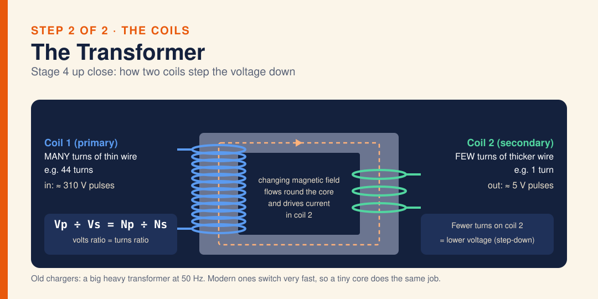

# Diagram · Phone Charger: The Transformer

Inside a phone charger, step 2: the transformer. A changing magnetic field flows round the core and drives current in coil 2. Coil 1 (primary) has many turns of thin wire (e.g. 44) and takes in about 310 V pulses; coil 2 (secondary) has few turns of thicker wire (e.g. 1) and gives out about 5 V. Vp ÷ Vs = Np ÷ Ns: fewer turns on coil 2 means lower voltage (step-down). Old chargers used a big, heavy 50 Hz transformer; modern ones switch very fast so a tiny core does the same job.

**Built from:** [Week 4 · Electricity](../t2/w4/term2-week4-science-unit3-electricity.md)

**Image:** [SVG](svg/science-diagram-phone-charger-2-transformer.svg)

[← All formula sheets](README.md)
