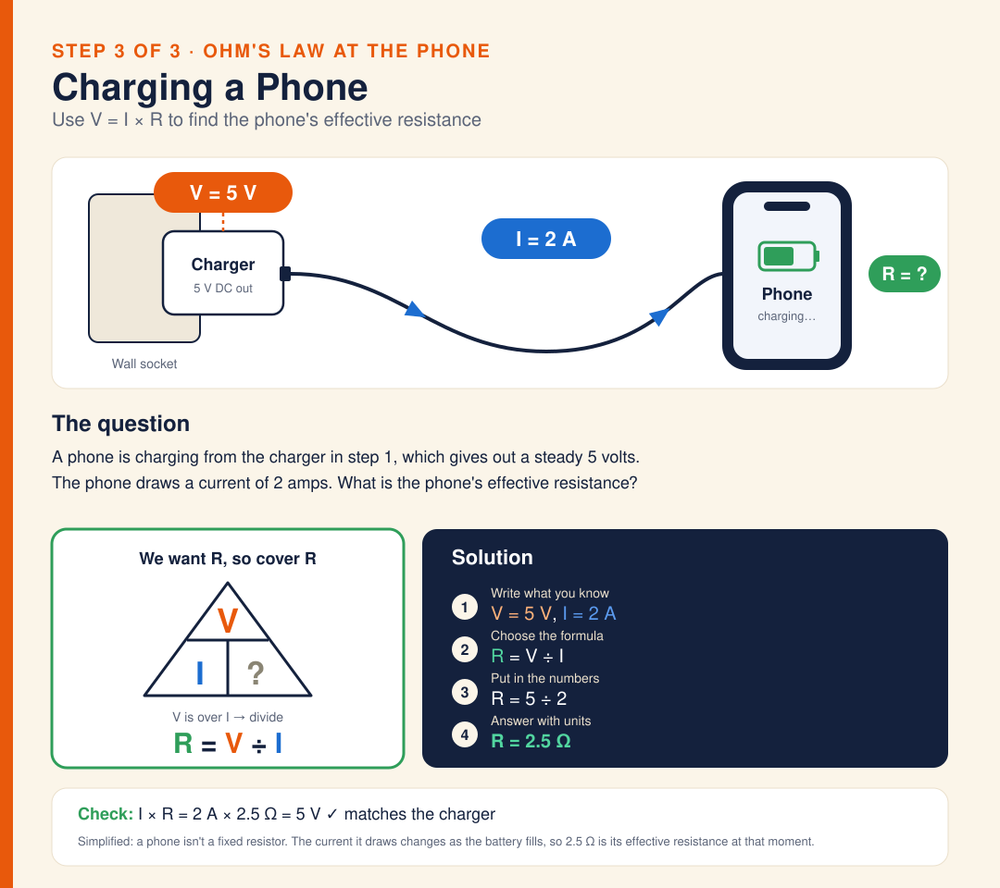

# Diagram · Phone Charger: Ohm's Law at the Phone

Inside a phone charger, step 3: Ohm's law at the phone. The charger from step 1 gives out a steady 5 V and the phone draws 2 A. We want R, so cover R in the triangle: V is over I, so R = V ÷ I = 5 ÷ 2 = 2.5 Ω. Check: I × R = 2 A × 2.5 Ω = 5 V, which matches the charger. Simplified: a phone isn't a fixed resistor, because the current it draws changes as the battery fills, so 2.5 Ω is its effective resistance at that moment.

**Built from:** [Week 4 · Electricity](../t2/w4/term2-week4-science-unit3-electricity.md)

**Image:** [SVG](svg/science-diagram-phone-charger-3-ohms-law.svg)

[← All formula sheets](README.md)
