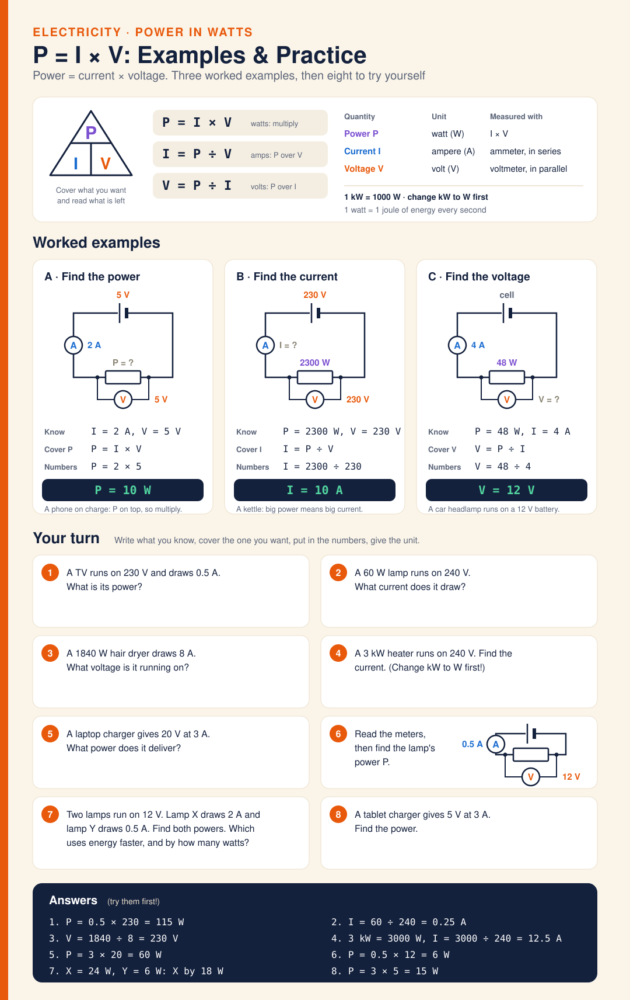

# Diagram · P = I × V: Examples & Practice

Power in watts. P = I × V: power (watts) = current (amps) × voltage (volts), and 1 W is 1 joule of energy every second. Formula triangle with P on top and I and V below: P = I × V, I = P ÷ V, V = P ÷ I. Change kW to W first (1 kW = 1000 W). Three worked examples with circuit diagrams: a phone on 5 V drawing 2 A uses 10 W; a 2300 W kettle on 230 V draws 10 A; a 48 W headlamp drawing 4 A runs on 12 V. Then eight questions to try (TV, lamp, hair dryer, a 3 kW heater, reading meters off a circuit, comparing two lamps), with answers and working at the bottom.

**Answers:** 1. 115 W · 2. 0.25 A · 3. 230 V · 4. 12.5 A · 5. 60 W · 6. 6 W · 7. X = 24 W, Y = 6 W, so X by 18 W · 8. 15 W

**Image:** [SVG](svg/science-diagram-power-practice.svg) · **Electricity only:** [electricity.html](electricity.html)

[← All formula sheets](README.md)
